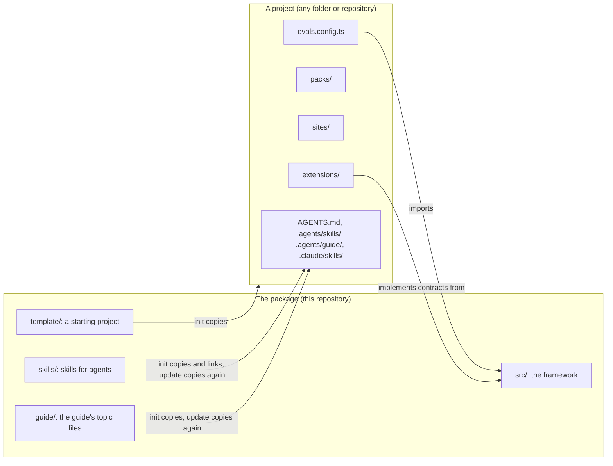
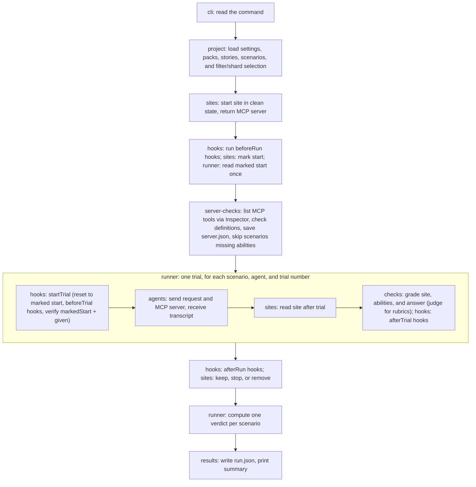

# Architecture

Module boundaries, execution flows, and core invariants of the `wp-ability-evals` package. [CONTEXT.md](../CONTEXT.md) defines the shared vocabulary used throughout the codebase.

## Contents

- [The package and a project](#the-package-and-a-project)
- [One run](#one-run)
- [The parts](#the-parts)
- [What keeps it modular](#what-keeps-it-modular)
- [How a project's files are checked](#how-a-projects-files-are-checked)
- [How hooks run](#how-hooks-run)
- [How a trial starts](#how-a-trial-starts)
- [How a wp-env site works](#how-a-wp-env-site-works)
- [What keeps a trial clean](#what-keeps-a-trial-clean)
- [How a trial is judged](#how-a-trial-is-judged)
- [How a scenario is proved without an agent](#how-a-scenario-is-proved-without-an-agent)
- [How the viewer works](#how-the-viewer-works)

## The package and a project

A project depends on the package and never modifies it. Project extensions (agents, judges, entity types, site kinds, hooks) register through `evals.config.ts` using the same contracts as built-in implementations.

## One run

Trials run sequentially on a site because they share its state. `beforeScenario` and `afterScenario` hooks wrap the trials of each eligible scenario.

## The parts

Dependencies point strictly downward in this table. Nothing imports `runner`, `verify`, or `cli`; every folder may import `errors.ts`.

| In `src/` | Owns | May import |
| --- | --- | --- |
| `errors.ts` | Purpose-built domain errors | nothing |
| `mcp-server.ts` | Site MCP server address (`url`, optional `inspectUrl`), headers, and `LookupTools` presentation | nothing |
| `process.ts` | Running external commands (Docker, wp-env, agents, Inspector) | nothing |
| `files/` | Reading YAML/JSON and shared shape-validation helpers | nothing |
| `scenarios/` | Story file format (`story`, `given`, `scenarios`), operators, ability expectations, validation, and loading | `files` |
| `packs/` | Pack manifest format, validation, and loading | `files`, `scenarios` |
| `entities/` | Built-in entity types (`posts`) and `EntityType` reader/writer contracts | nothing |
| `sites/` | Site file format, validation, and built-in site kinds (`wp-env`) | `files`, `scenarios` (types), `entities`, `mcp-server`, `process`, `server-checks` (types, `validate`) |
| `programs/` | Launching installed CLIs (`claude`, `codex`) isolated from user settings | `files`, `process` |
| `agents/` | Built-in agent adapters (`claude-code`, `codex`) and `Agent` contract | `files`, `mcp-server`, `process`, `programs` |
| `judge/` | Built-in rubric judges (`claude`, `codex`) and `Judge` contract | `files`, `process`, `programs` |
| `checks/` | Site, ability, tool, and answer checks plus check registry | `files`, `scenarios`, `packs`, `entities`, `mcp-server`, `agents` (types), `judge` |
| `server-checks/` | MCP Inspector tool listing (`--strict`), pack comparison, ability definition & opt-in contract checks (`requiredHints`, `hints`, `directTools`), validation/merge, `server.json` snapshot, and skipped-scenario resolution | `files`, `mcp-server`, `process`, `scenarios`, `packs` (types) |
| `results/` | Run/trial JSON contracts, incremental trial saving, `server.json` / `run.json` writing, reading, summaries, and `merge` | `scenarios`, `entities` (types), `checks`, `agents` (types), `server-checks` (types) |
| `coverage/` | Per-ability coverage and trend calculation from latest scenario verdicts | `packs` (types), `scenarios`, `checks`, `results`, `server-checks`, `agents` (types) |
| `hooks/` | Six lifecycle points, `runHooks`, `startRunOn` / `endRunOn`, `startTrial`, and `createGiven` | `files`, `mcp-server`, `scenarios`, `entities` (types), `sites`, `checks`, `results` |
| `config/` | Project settings (`Config`), validation, and extension points | `files`, `agents`, `entities`, `sites`, `judge`, `hooks` (types), `server-checks` (types, `validate`) |
| `project/` | Full project loading, cross-file validation, site construction, scenario filtering/sharding (`scenariosOn`), and judge lookup | `config`, `packs`, `scenarios`, `entities`, `sites`, `server-checks` (types), `agents` (types), `judge` (types) |
| `runner/` | Single-trial execution (`run-trial.ts`), full run loop, and verdict aggregation | everything above |
| `verify/` | Agent-free scenario proofs: pure step decisions (`steps.ts`), runner, and report formatting | everything above except `runner` |
| `init/` | Project scaffolding (`init`) and hash-checked guide/skill syncing (`update`) from `template/`, `skills/`, and `guide/` | `config` |
| `viewer/` | Local read-only HTTP server (`server.ts`) and self-contained static exporter (`export.ts`) | `results`, `coverage`, `packs` (types) |
| `cli/` | Command parsing (`main.ts`) and subcommand dispatch | `runner`, `verify`, `project`, `results`, `hooks`, `init`, `viewer`, `server-checks`, `coverage` |
| `index.ts` | Public package surface for downstream projects | re-exports only |

The browser viewer lives outside `src/` in `viewer/` at the repository root and is bundled by `scripts/build-viewer.mjs` (esbuild) into `dist/viewer/page/`. It imports only types re-exported from `src/results/types.ts`.

## What keeps it modular

- **Package decoupled from projects:** Projects consume `src/index.ts` and update via npm/git without patching `src/`.
- **Data separated from code:** Packs and site files are pure data (YAML/JSON); executable logic lives in `src/`, `hooks/`, or `extensions/`.
- **One contract per folder:** Each module's `types.ts` defines its boundary. The runner speaks `Agent`, `Site`, and `Check`, never Claude Code or `wp-env`.
- **Symmetric extension points:** `agents`, `judges`, `entityTypes`, `siteKinds`, and `hooks` in `src/config/types.ts` use the exact same interfaces for built-ins and project extensions.
- **Fixed lifecycle points, user-supplied hooks:** The framework owns *when* hooks run and *what* hook failures mean; projects own *what* hooks do.
- **One meeting point:** `src/runner/run-trial.ts` is the sole place where a site, an agent, and the checks meet.
- **Declarative scenarios:** Scenarios declare site changes, abilities, and answers; `src/checks/registry.ts` derives which checks execute from `kind` and `expect`.

## How a project's files are checked

Because agents author packs and live runs spend tokens, invalid files are rejected at load time:

- **Single load-and-validate pipeline:** `project/load.ts` validates every command (`validate`, `list`, `site`, `verify`, `run`, `view`), so `validate` never accepts what a run would reject.
- **Co-located format validators + cross-checks:** `scenarios/validate.ts`, `packs/validate.ts`, `sites/validate.ts`, and `config/validate.ts` validate individual schemas; `project/cross-checks.ts` verifies cross-file invariants (expected/forbidden abilities exist in a pack, entity fields exist on their entity type, site packs exist, and `given`/`expect.site` entity types have writers for the target site kind). Valid no-ops (such as an unlisted custom entity type or an ability named by no scenario) emit notices rather than errors.
- **Story files and `given` merging:** `scenarios/load.ts` reads story files exclusively and merges story-level and scenario-level `given` (rejecting duplicate keys across levels). Downstream code (`runner`, `checks`, `results`) receives a flat `Scenario` with its merged `given`, while `Pack.stories` retains story provenance.
- **Single operator & ability-entry parsers:** Only `scenarios/operators.ts` distinguishes `$`-prefixed operators (`$new`, `$contains`) from plain values, and only `scenarios/abilities.ts` parses the two forms of `expect.abilities` entries (name vs name-to-arguments map). Validation, cross-checks, checks, and `verify` all delegate to these two modules.
- **Rubric pairs required:** `scenarios/validate.ts` requires both `reference` and `wrong` next to every `expect.answer.rubric`.
- **Collect-all errors:** `InvalidProjectError` aggregates all problems with file paths in one pass (after `evals.config.ts` itself loads cleanly). Scenario IDs follow `<pack>/<file>/<slug>`.

## How hooks run

- **Clean state vs marked start (`sites/types.ts`):** `start()` restores the site's clean state and clears any marked start; `markStart()` records the post-`beforeRun` baseline; `reset()` restores the marked start (or clean state if unmarked).
- **Shared run wrappers (`hooks/run-on-site.ts`):** `startRunOn` starts the site, runs `beforeRun` hooks, and calls `markStart()`; `run`, `verify`, `site start`, and `site check` all go through it. `endRunOn` wraps the body of `run` and `verify` so `afterRun` hooks and the site's `afterRun` action (`keep`/`stop`/`remove`) execute even on errors, preserving both body errors and cleanup errors.
- **Point runner (`hooks/run.ts`):** Executes hooks sequentially. A failing `before*` hook stops later hooks at that point; `after*` hooks always run once their `before*` point was reached, even if another `after*` hook throws. Every failure names both the point and hook function.
- **Failure semantics and check validation:** Framework policy decides the effect of each failure (`beforeRun` aborts; `beforeScenario` marks all scenario trials errored; `beforeTrial`/`afterTrial` marks that trial errored; `afterScenario`/`afterRun` records into `run.json` `errors` and exits non-zero). Because Node runs project JS/TS without runtime type checking, return values from `afterTrial` hooks are validated and rejected if neither `undefined` nor `CheckResult[]`. Hooks have no timeout.

## How a trial starts

- **Unified start gate (`hooks/start-trial.ts`):** `startTrial` resets to the marked start, runs `beforeTrial` hooks, reads the site, and compares it against `markedStart + scenario.given`. Both `run` and `verify` call `startTrial`. `runner/run.ts` captures `markedStart` once right after `startRunOn`.
- **Shared diff logic (`checks/site.ts`):** `startDifferences` reuses the site check's comparator (without operators) so unexpected extra, missing, or altered items stop the trial before the agent runs (`SiteNotPreparedError`). If `given` items are missing and no `beforeTrial` hooks are registered, the error points to `createGiven()`.
- **Explicit seeding:** `createGiven()` (`hooks/create-given.ts`) is an ordinary `beforeTrial` hook calling `site.apply(scenario.given)`. Nothing creates starting content implicitly.
- **Reset vs prep failure (`SiteNotResetError`):** A failed `reset()` throws `SiteNotResetError` so the runner knows `beforeTrial` hooks never ran and `afterTrial` hooks are not owed. Any later start failure still runs `afterTrial`.
- **Site readings preserved:** Both `site.before` and `site.after` are stored in the trial file whenever both readings completed, including when a later check or judge throws (`runner/run-trial.ts`).

## How a wp-env site works

`sites/wp-env.ts` manages a local Docker-based WordPress site configured via `wpEnv` in `sites/<name>.json`:

- **Two-snapshot lifecycle:** First start (or any `wpEnv` change) boots containers, resets the DB, sets an owner-realistic site title, creates an Application Password for MCP auth, and saves the **clean snapshot**. `start()` restores the clean snapshot and deletes any marked-start snapshot. `markStart()` captures a second **marked-start snapshot** (retaining the same auth credentials). `reset()` restores the marked-start snapshot over the database (note: SQL import does not drop extra tables created after the snapshot).
- **Per-entity PHP evaluation:** `state()` runs all pack entity readers in one WP-CLI call, wrapping each reader in its own `eval` so parse/runtime errors report the entity type name and line offset. `apply(change)` runs entity writers in one WP-CLI call as admin, passing the change payload as JSON on stdin (`changeWith`) rather than interpolating values into PHP.
- **Local state & cleanup:** Site state lives under `.wp-ability-evals/sites/<name>/` (generated `.wp-env.json`, snapshots, MCP URL/auth, Compose project name). `remove()` runs `wp-env cleanup --force` (avoiding `wp-env destroy`, which deletes shared database Docker images used by other wp-env sites) and removes the site folder.
- **Path resolution & port isolation:** Relative paths in `wpEnv` resolve from the project root and must exist before Docker runs (`sites/wp-env-config.ts`). Containers are targeted by Docker Compose project name rather than port, and `start()` fails early if the configured port is held by another site or process.
- **MCP presentation:** Bundled `wp-plugins/abilities-as-tools` exposes one MCP tool per ability; `wp-env` still attaches MCP Adapter `LookupTools` metadata so checks transparently handle either presentation.

## What keeps a trial clean

Each trial runs in a fresh temporary directory outside any git repository, deleted when the trial ends. Agents receive only the site's MCP server tools (plus their own tool search) and zero indication that the session is an evaluation.

- **Claude Code (`programs/claude.ts`):** Runs `claude --print` with `--setting-sources ""`, `--strict-mcp-config`, `--disable-slash-commands`, `--no-session-persistence`, `CLAUDE_CODE_DISABLE_AUTO_MEMORY=1`, and a minimal environment allowlist (`HOME`, `USER`, `LOGNAME`, `PATH`, `TMPDIR`). In `api-key` mode it passes `ANTHROPIC_API_KEY` plus optional `ANTHROPIC_BASE_URL` and `ANTHROPIC_CUSTOM_HEADERS`.
- **Codex (`programs/codex.ts`):** Runs `codex exec --json` with `--ignore-user-config`, `--ephemeral`, `--skip-git-repo-check`, `--sandbox read-only`, an empty temp `HOME` (blocking `~/.agents/skills`), and individual `--disable` / `--config` flags turning off shell, image tools, web search, sub-agents, bundled skills, plugins, apps, and memory. In `login` mode it points `CODEX_HOME` at `~/.wp-ability-evals/codex`; in `api-key` mode it passes `CODEX_API_KEY` (from `OPENAI_API_KEY`) and, when `OPENAI_BASE_URL` is set, `--config openai_base_url=...`.

## How a trial is judged

- **Derived check set (`checks/registry.ts`):** Every trial runs site-state, allowed-server, and known-abilities checks. `read` scenarios forbid successful write abilities; `none` scenarios forbid any ability call (even refused). `expect.abilities`, `expect.forbidden`, `expect.answer.contains`, and `expect.answer.rubric` each activate their check.
- **Deterministic `$new` binding (`checks/site.ts`):** Keys without `$new` are looked up literally (`expected, but not found` catches typos). Each `$new` label is matched independently against all newly created, unnamed items (`newItems`); matching is order-independent and requires a strict 1-to-1 fit, failing with diagnostics when zero or multiple items match. `$contains` shares `textsMissingFrom` (`checks/answer.ts`) and is evaluated only on scenario expectations, never on raw site data.
- **Ability & argument resolution (`checks/abilities.ts`):** Maps tool calls to abilities across both presentations—direct tools (`/` → `-`, tool input = ability input) and `LookupTools` (`runTools` with `nameArgument`, `inputArgument`, and optional `prefix` for hybrid servers). Expected abilities require at least one error-free call matching every named argument (`same` in `checks/site.ts`; lists mean any-of). Order and call counts are never checked. Forbidden abilities fail on any call, including errors.
- **Server checks (`server-checks/`):** Before trials begin, `inspectServer` invokes MCP Inspector (`--strict`, using `inspectUrl ?? url` in an isolated temp home so `~/.mcp-inspector` stays untouched), compares exposed tools with pack lists, runs definition checks (`boolean-schema`/portability, missing description, `readOnlyHint` mismatch) plus any opt-in `serverChecks` contract rules (`requiredHints`, per-ability `hints`, and `directTools` merged from `evals.config.ts` and `sites/<name>.json`), and returns both `ServerFindings` (stored in `run.json`) and `ServerSnapshot` (written to `server.json`). Scenarios referencing missing abilities are skipped without launching agents.
- **Rubric judges & verdicts (`judge/`, `runner/verdict.ts`):** Judges run tool-free through the same isolated CLIs. Judge failures mark the trial "could not be judged" rather than failing it. A scenario passes only when every trial of every agent passes; `known-defect` and `to-be-implemented` failures report as expected.
- **Results & merging (`results/`):** Each trial writes `trials/<scenario-id>/<agent>.<trial>.json` immediately upon completion so interrupted runs preserve paid work; `server.json` captures Inspector output; `run.json` summarizes setup, `models`, `serverChecks`, `verdicts`, `trials`, and top-level `errors`. `mergeRuns` (`results/merge.ts`) combines sharded or per-agent run folders after asserting matching `site`, matching `trialsPerScenario`, and zero duplicate `(scenarioId, agent, trial)` keys, then copies trial files and `server.json` and recomputes multi-agent verdicts.

## How a scenario is proved without an agent

`verify/` mirrors `run/` without agents or verdicts (`verify/` may not import `runner/`):

- **Shared selection & lifecycle:** Calls `scenariosOn` (`project/site.ts`, supporting `--filter` and `--shard`), `startRunOn`, `startTrial`, and `endRunOn`, running all six hook points with `run.agents = []` and `agent = 'verify'` (ignoring checks returned by `afterTrial` hooks).
- **Pure step decisions (`verify/steps.ts`):** Each of the up to five steps (`start`, `no change`, `the change`, `contains`, `rubric`) is decided by a pure function tested with plain values. `siteCheckOf` (`checks/site.ts`) runs the exact trial site check without requiring a transcript.
- **Plain-value materialization:** `changeToMake` converts `$new` items into creations under their label key (after `labelInUseStep` verifies the label does not collide with an existing key) and turns `$contains` fields into space-joined text appended to the starting value.
- **Failure vs unchecked vs skipped:** Scenario bugs produce `FAILED:`; external failures (hooks, site, judge errors) produce `COULD NOT BE CHECKED:`; both exit non-zero. `--no-judges` and `contains` without `reference` record as skipped and exit zero. `verify` writes no files; stdout (`verify/report.ts`) is the output.

## How the viewer works

The viewer renders ability coverage, MCP server audit findings, historical trends, run summaries, and per-trial site diffs without requiring users to inspect JSON directly:

- **Live read-only server (`src/viewer/server.ts`):** Binds strictly to `127.0.0.1` and accepts only `localhost` / `127.0.0.1` `Host` headers to block cross-origin DNS rebinding against local transcripts. Every file request resolves through `runFilePath` (`results/read.ts`) so paths cannot escape a run folder. `--results <dir>` overrides `resultsDir`.
- **Static export (`src/viewer/export.ts`):** `view --export <out-dir>` writes a self-contained static bundle (`index.html` with `window.__WP_ABILITY_EVALS_STATIC__ = true`, `main.js`, `main.css`, plus precomputed `data/overview.json`, `data/runs.json`, and `data/runs/<id>/{run.json,server.json,trials/...}`) for CI artifacts or static hosting without running Node.
- **Server-computed coverage (`src/coverage/`):** Coverage counts, "Needs attention" sorting, "Asked for not built yet", and historical trend points are computed on the server (or at export time) using the same pack-coverage logic `validate` uses. Each trend point carries forward every scenario's latest verdict up to that run so `--filter` or sharded runs do not create false dips.
- **Browser UI (`viewer/`):** React with `@wordpress/dataviews` for tables, `@wordpress/ui` for layout/controls, and `@wordpress/components` only where the first two lack a primitive; hash-based routing keeps server routing trivial. `viewer/site-changes.ts` computes human-readable site diffs purely from `site.before` and `site.after` (tested in `test/site-changes.test.ts`), leaving pass/fail decisions solely to the saved check results.
