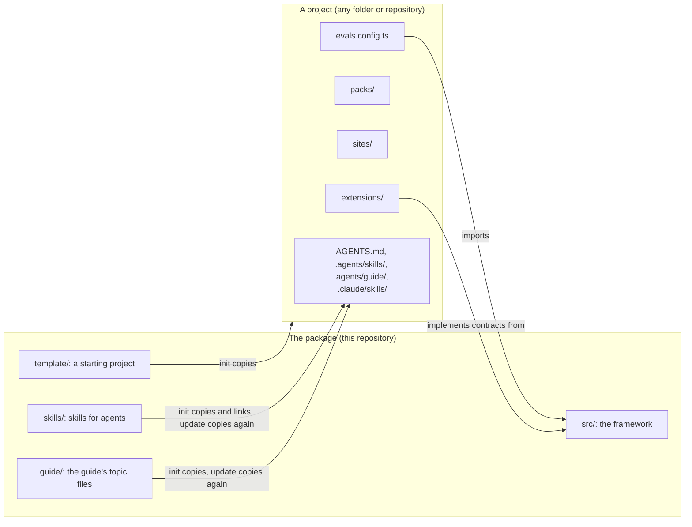
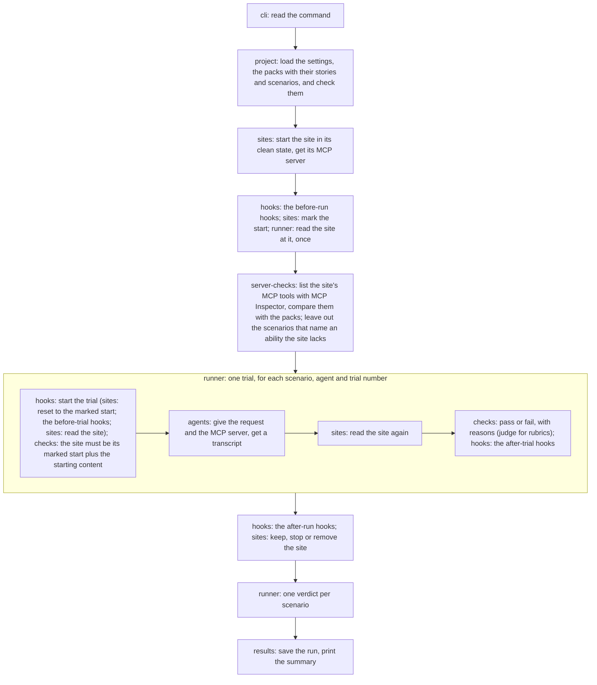

# Architecture

How the parts fit. `CONTEXT.md` defines the words.

## The package and a project

A project depends on the package and never changes it. What it adds, it names in its config: an agent, an entity type, a kind of site, a hook. The built-in ones are made the same way, so a project's own are not second-class.

## One run

Trials run one at a time, because they share the site. The before-scenario and after-scenario hooks run around the trials of each scenario.

## The parts

| In `src/`       | Owns                                                                                                              | May import                                                                             |
| --------------- | ----------------------------------------------------------------------------------------------------------------- | -------------------------------------------------------------------------------------- |
| `errors.ts`     | The errors the evals raise on purpose                                                                             | nothing                                                                                |
| `mcp-server.ts` | The address of a site's MCP server, and how it presents abilities                                                 | nothing                                                                                |
| `process.ts`    | Running an outside program: Docker, wp-env, an agent                                                              | nothing                                                                                |
| `files/`        | Reading a YAML or JSON file; the small questions every format's rules share                                       | nothing                                                                                |
| `scenarios/`    | The story file format (a story, its starting content, its scenarios), its rules, and loading story files          | `files`                                                                                |
| `packs/`        | The pack format, its rules, and loading a pack folder                                                             | `files`, `scenarios`                                                                   |
| `entities/`     | Entity types, and how to read and write each on every kind of site                                                | nothing                                                                                |
| `sites/`        | The site file format and its rules; one file per built-in kind of site                                            | `files`, `scenarios` (types), `entities`, `mcp-server`, `process`                      |
| `programs/`     | Starting an installed program (Claude Code, Codex) with nothing of the user's but the sign-in                     | `files`, `process`                                                                     |
| `agents/`       | One adapter per built-in agent                                                                                    | `files`, `mcp-server`, `process`, `programs`                                           |
| `judge/`        | What a judge is; one file per built-in judge                                                                      | `files`, `process`, `programs`                                                         |
| `checks/`       | The rules that pass or fail a trial                                                                               | `files`, `scenarios`, `packs`, `entities`, `mcp-server`, `agents` (types), `judge`     |
| `server-checks/` | The server checks: listing a site's MCP tools with MCP Inspector, comparing them with the packs, and which scenarios a run leaves out | `files`, `mcp-server`, `process`, `scenarios`, `packs` (types) |
| `results/`      | The shape of a run's results; saving, reading back and summarizing                                                | `scenarios`, `entities` (types), `checks`, `agents` (types), `server-checks` (types)                            |
| `coverage/`    | Each listed ability's coverage, counted from each scenario's latest verdict; reading it from the results folder | `packs` (types), `scenarios`, `checks`, `results`, `server-checks`, `agents` (types) |
| `hooks/`        | The six points of a run and their hooks; a run's start and end and a trial's start on a site; `createGiven`       | `files`, `mcp-server`, `scenarios`, `entities` (types), `sites`, `checks`, `results`   |
| `config/`       | A project's settings, their rules, and its extension points                                                       | `files`, `agents`, `entities`, `sites`, `judge`, `hooks` (types)                       |
| `project/`      | Loading a whole project, the rules that span its files, building one of its sites, which judge grades which agent | `config`, `packs`, `scenarios`, `entities`, `sites`, `agents` (types), `judge` (types) |
| `runner/`       | One trial, a whole run, the verdict                                                                               | everything above                                                                       |
| `verify/`       | Proving a scenario on a site without an agent: the steps, what each decides and what is printed                   | everything above but `runner`                                                          |
| `init/`         | Creating a new project from `template/`, `skills/` and `guide/`, and taking newer skills and a newer guide into one | `config`                                                                               |
| `viewer/`       | The server that shows the coverage of the abilities and the saved runs to a browser on this machine               | `results`, `coverage`, `packs` (types)                                                 |
| `cli/`          | The commands                                                                                                      | `runner`, `verify`, `project`, `results`, `hooks`, `init`, `viewer`, `server-checks`, `coverage`                    |
| `index.ts`      | What a project may import                                                                                         | re-exports only                                                                        |

Dependencies point one way, down this table. Nothing imports `runner`, `verify` or `cli`, and every folder may import `errors.ts`.

The page the viewer serves is not in `src/`: it is browser code, in `viewer/` at the top of the repository, bundled into `dist/viewer/page/`. It imports only the types in `results/types.ts`, which names the parts of a trial's file again for it: the scenario with what it expects, the checks, the readings of the site and the transcript with its tool calls.

## What keeps it modular

- **The package apart from projects.** Nobody edits the package to write evals. A project updates the package by changing its version.
- **Data apart from code.** Packs and sites are files a person or an agent edits. A pack holds no code.
- **One contract per folder.** Each folder's `types.ts` says what the folder gives the others. The runner knows `Agent`, `Site` and `Check`, never Claude Code, wp-env or a particular check.
- **Extension points in the config.** `agents`, `entityTypes`, `siteKinds` and `hooks` in `src/config/types.ts`. A built-in agent is a function that returns an `Agent`, and so is a project's own.
- **Fixed points, and hooks that do the work.** The runner knows where in a run a site is prepared and cleaned up, never how. That is a project's hook.
- **One meeting point.** `runner/run-trial.ts` is the only place where a site, an agent and the checks meet.
- **Scenarios say what, not how.** A scenario names abilities and site changes. Which checks run follows from its kind and its expectations (`checks/registry.ts`).

## How a project's files are checked

Agents write the packs and scenarios, and a live run costs money, so a file that can't work is rejected when it is loaded.

- **Loading and validating are one step** (`project/load.ts`). `validate`, `list` and later `run` all go through it, so `validate` can't accept what a run would reject.
- **Each format has its rules next to its type**: `scenarios/validate.ts`, `packs/validate.ts`, `sites/validate.ts`, `config/validate.ts`. The settings' rules reach what the package runs itself: the reader and the writer that a project's entity type has for a `wp-env` site are PHP, so each must be text, and those for a project's own kind of site are that kind's business. The rules that need several files are in `project/cross-checks.ts`: an expected or a forbidden ability that no pack lists, a field its entity type does not have, in `expect.site` or in `given`, a site that names a pack the project does not have, which names the pack's folder when one is there that the settings leave out, a `given` or an `expect.site` for an entity type that has no writer for the kind of site its pack runs on. What is valid and does nothing is a note of `validate`, not a problem: an entity type of the project's own that no pack lists, so no site reads it.
- **A file in a pack's `scenarios/` folder is a story file**: the story in a person's words, then the scenarios made from it, which are data. A story may have no scenarios yet. Only this format is read; a file that is still a list of scenarios is rejected with how to change it.
- **Starting content is joined when a file is loaded** (`scenarios/load.ts`). `given` at the story is for all its scenarios, and a scenario adds its own; the same item at both levels is a problem. A loaded scenario carries the two joined, so the runner, the checks and the results never ask which story it came from. A pack keeps its stories next to the flat list of scenarios: each story's file name, text, own `given` and the ids of its scenarios.
- **How starting content gets onto a site** is the section "How a trial starts" below.
- **An operator is a key that starts with `$`** (`scenarios/operators.ts`), so it can't be taken for a field, a plain value or a typo. `expect.site` has two: `$new: true` on an item the agent should create, and `{ $contains: [texts] }` as a field's value. `scenarios/validate.ts` reports an operator it does not know, a `$new` that is not `true` or that stands without a field, a `$contains` that is not a list of text, and any operator in `given`, which is put on a site as it is written. The cross-checks leave an operator out when they ask whether an entity type has a field.
- **An entry of `expect.abilities` is a name, or that one name mapped to arguments** (`scenarios/abilities.ts`), so the rules, the cross-checks and the check read its two forms in one place. `scenarios/validate.ts` reports an entry that is neither, one with several keys, which is what arguments at the depth of the name give, and an argument that is not text, a number, `true` or `false`, or a list of those. A list means one of its values, so an argument whose own value is a list or a mapping can't be expected, and the rule says so. It also reports an ability that is under both `expect.abilities` and `expect.forbidden`, and `expect.forbidden` in a `none` scenario, where no ability may run and it adds nothing.
- **A rubric comes with two answers** (`scenarios/validate.ts`): `expect.answer.reference`, which should pass it, and `expect.answer.wrong`, which should fail it. A rubric is graded by a model, so nothing else shows that it tells right from wrong. `verify` has every judge grade both.
- **Every problem is collected with its file** (`InvalidProjectError`), so they can be fixed in one pass. One exception: packs and sites are checked only once the settings are valid, because the settings say where they are.
- **A scenario's id is `<pack>/<file>/<slug>`.** That keeps ids unique across packs that live in different repositories, and says where a scenario is. The file's name is also its story's name.

## How hooks run

A hook is a function of a project, named in its settings at one of six points of a run (`hooks/types.ts`). The framework fixes the points, their order and what a failure means. What a hook does is the project's own code.

- **The order of a run.** The site starts in its clean state. The `beforeRun` hooks run, and the site marks its start. For each scenario the `beforeScenario` hooks run; then, for each agent and trial, the site is reset to its marked start, the `beforeTrial` hooks run, the site is read and compared with what the scenario says it starts with, the trial runs and the `afterTrial` hooks run; then the `afterScenario` hooks. At the end the `afterRun` hooks run, and the site is kept running, stopped or removed, as `afterRun` in its site file says.
- **A site has a clean state and a marked start** (`sites/types.ts`). `start()` leaves the site as it was when it was set up and forgets a marked start. `markStart()` marks the site as it is now. `reset()` returns to the marked start, or to the clean state when none is marked. So what a before-run hook put on the site is there in every trial, and is gone again at the next start.
- **One function starts a run on a site** (`hooks/run-on-site.ts`): start the site, run the before-run hooks, mark the start. `run` and `verify` call it, and so does `site start`, so that a person sees the site as a trial finds it. It is in `hooks/` because nothing but `cli` may import `runner`.
- **One function ends it** (`endRunOn`, in the same file). It is handed the work of the run and does it, then runs the after-run hooks and does what the site file says, whatever the work did. What goes wrong at the end is returned, so the trials that ran still count. When the work itself throws, as when the site can't be read, its failure is thrown after the end with what went wrong there, as `startRunOn` does with a before-run failure. `run` and `verify` both go through it, so neither can lose an after-run failure.
- **One function runs the hooks of a point** (`hooks/run.ts`), in the order written. A before-hook that fails stops the hooks after it, because they build on what it prepared. After-hooks clean up, so each one runs even when another failed. Every failure names the point and the hook, by the function's name.
- **Each level runs its own two points.** The run's are in `hooks/run-on-site.ts`, and a scenario's in `runner/run.ts`. A trial's before-point is in `hooks/start-trial.ts`, and its after-point in `runner/run-trial.ts`. `verify/verify.ts` runs a scenario's and a trial's points for a proof. After-hooks run once the before-hooks of their point were reached, whatever failed in between.
- **What a failure means is the framework's decision.** A `beforeRun` hook that fails stops the run before any trial; the after-run hooks still run, and the site is left as it is, whatever its site file says. A `beforeScenario` hook that fails makes every trial of that scenario "could not be judged", and none of them runs. A `beforeTrial` or `afterTrial` hook that fails makes its trial "could not be judged". An `afterScenario` or `afterRun` hook that fails costs no trial: the run goes on, and ends with an error.
- **What goes wrong around the trials is saved with the run**, as `errors` in `run.json`: an after-scenario or after-run hook that failed, or a site that could not be stopped or removed. The summary prints it, and the command ends with an error.
- **An after-trial hook may return checks.** They are added to the trial's checks and count like any other. Node runs a project's code without checking its types, so what a hook returns is checked: anything but nothing or a list of checks is a failure of the hook. A trial that could not be judged keeps no checks.
- **A hook gets the same `Site` on every kind of site**, with `state()` to read it and `apply(change)` to change it. A wp-env site adds `wp(args)`, which runs WP-CLI as the admin user, and `isWpEnvSite(site)` tells such a site apart.
- **A hook has no time limit.** It is the project's own code, and one that never ends holds the run.

## How a trial starts

A scenario's `given` says what is on the site before the agent works. A hook puts it there, and the framework makes sure the site really starts that way.

- **One function starts a trial on a site** (`startTrial` in `hooks/start-trial.ts`): the site goes back to its marked start, the before-trial hooks run, the site is read, and the reading is compared with what the scenario declares. `run` calls it, and so does `verify`, which prepares a site for a scenario without an agent. It is in `hooks/` because nothing but `cli` may import `runner`.
- **The start a scenario declares is the site's marked start plus its `given`.** `runner/run.ts` reads the site once, right after `startRunOn`, when the before-run hooks ran and the start is marked, and hands that reading to every trial. So what a before-run hook seeded is part of every start, and no scenario declares it. `site start` does not read it, because it starts no trial.
- **The comparison is the site check's** (`checks/site.ts`). `startDifferences` compares the marked start with the site as found, with `given` as the declared change. Of a `given` item only the named fields count. Everything else must be as at the marked start: an item that is in neither, an item that is gone and one that changed are each a difference. Two differences read another way before a trial than after it, so the words are passed in.
- **A difference stops the trial before the agent runs** (`SiteNotPreparedError`). The trial "could not be judged", and its reason names each difference. Where a `given` item is missing and the project has no before-trial hook, the reason also names `createGiven()`. `startProblem` decides all of this from the two readings, the `given` and the hooks, and is tested.
- **Nothing creates `given` behind the scenes.** `createGiven()` (`hooks/create-given.ts`) is a hook that comes with the package. A project lists it under `hooks.beforeTrial`, and a new project does. It hands the scenario's `given` to `site.apply`. A project that prepares its sites another way leaves it out, and the comparison holds either way.
- **A site changes through one method, `apply(change)`** (`sites/types.ts`). The change has the shape of `expect.site`, which `given` has too. A built-in kind of site makes it through each entity type's writer for that kind. A project's own kind makes it in its own way, so the built-in entity types need nothing from it.
- **An entity type has a writer next to its reader**, per kind of site (`entities/types.ts`). A writer makes one item have given fields: it creates the item under its key, changes it, or removes it. What it makes, the reader reports under the same key: the `posts` writer for `wp-env` gives a new post its key as its slug, which WordPress keeps for a draft too. A post without a slug has no such key, so the reader lists it under `#` and its ID. The writer finds such a post by that ID, to change or remove it, and refuses to create one under a key of that form.
- **A failed reset is told apart** (`SiteNotResetError`). It means the before-trial hooks were not reached, so the after-trial hooks do not run. After any other failure of the start they do.
- **Both readings of a trial are kept** in its result and its file: the site as the agent found it, which is the reading the comparison passed, and the site as the agent left it. A trial that ended before both were read keeps neither. A trial that could not be judged after that keeps them, and the agent's transcript too: a check that throws, as when a judge gives no verdict, costs the checks and nothing else (`runner/run-trial.ts`).

## How a wp-env site works

A wp-env site is a local WordPress in Docker (`sites/wp-env.ts`). Its site file holds a wp-env configuration under `wpEnv`.

- **Setup happens on the first start**, and again when the site file's `wpEnv` changes: start the containers, reset the database, give the site a title an owner could have chosen in place of the folder name wp-env gives it, create the sign-in for the MCP server (an application password), then save a snapshot of the database. That snapshot is the site's clean state.
- **Every start restores the clean snapshot**, and removes the snapshot of a marked start.
- **Marking the start saves a second snapshot** next to the first. It is taken from a site that was restored from the clean snapshot, so it holds the sign-in too, and the sign-in stays valid.
- **A reset restores the marked start**, or the clean snapshot when no start is marked.
- **A restore imports a snapshot over the database.** It does not remove a table that was created after the snapshot was taken, such as one of a plugin that a hook or an agent activated later.
- **The state is read with WP-CLI**, which runs the `wp-env` reader of each entity type the site's packs name, in one call. Each reader runs through an `eval` of its own in that call, so a reader that can't be parsed or that fails is named, with the line in it: the PHP of all the readers joined would name none, and its line numbers would point nowhere in the project.
- **A change is made with WP-CLI too**, in one call, as the admin user. The PHP holds the `wp-env` writer of each entity type the change names, each as a function of an item's key and its fields. The change itself is not in the PHP: it is read as JSON from the input, so a title that holds a quote or a `$` is never code. Each writer is made through an `eval` of its own before anything changes, so a writer that can't be parsed is named, with the line in it. A writer fails by throwing, and the failure names the item: `Site local could not be changed: posts summer-sale: ...`.
- **What the site keeps between commands** is in the project, under `.wp-ability-evals/sites/<name>/`: the wp-env configuration, the two snapshots, the address of the MCP server with its sign-in, and the name of the site's Compose project. The folder is not committed.
- **Removing a site runs `wp-env cleanup --force`**, then removes the site's folder in the project. `cleanup` removes the site's containers and data. `wp-env destroy` was set aside, because it also removes Docker images, among them the database image that the other wp-env sites on the machine run on. `--force` answers the question wp-env asks first, which nobody is there to answer. The two images that wp-env built for the site stay, and a later setup of the site uses them again.
- **A path in `wpEnv` is read from the project folder** (`sites/wp-env-config.ts`). wp-env runs in the site's own folder and would look there. A path that is not on the machine stops the setup, because Docker would make an empty folder for it and the site would start without that plugin.
- **A plugin decides how the server presents abilities.** The MCP Adapter comes with three lookup tools. A site file that lists the package's `wp-plugins/abilities-as-tools` plugin gets one tool per ability on the same address, and the site file `init` writes lists it. The site file does not say which it is: the site hands out the names of the lookup tools, with the arguments of each tool that runs any ability that name the ability and hold its input, and the checks read any other tool of its server as an ability.
- **wp-env comes with the package.** WP-CLI runs straight in the site's container, because `wp-env run` takes seconds per call.
- **A site's containers are found by its Docker Compose project**, which wp-env names after the path of the site's config and states in `wp-env status --json`. Asking takes seconds, so the name is kept in the site's folder. Two projects on one machine may give their sites the same port, so a site found by its port could be another project's, and a reset would load one project's snapshot into the other's database. A start on a port that another site or program holds stops before wp-env runs, with what holds it.

## What keeps a trial clean

- The runner makes an empty folder for each trial, outside any repository, and the agent starts there. The folder is removed when the trial ends.
- Each agent adapter keeps the agent away from the user's settings, rules, skills and memory. The sign-in is the only thing it takes from the machine.
- An agent gets the tools of the site's MCP server and its own tool search, and nothing else.
- Nothing the agent can see says it is an evaluation.

For Claude Code (`programs/claude.ts`), that is: the installed `claude` command without a terminal; no user, project or local settings; no skills or commands; memory off; only the MCP server it is given, from a file outside its folder; and only the environment variables it needs to find the sign-in, so a run started from inside another agent's session behaves the same.

For Codex (`programs/codex.ts`), that is: the installed `codex exec` command; a Codex home of its own (`~/.wp-ability-evals/codex`), because Codex keeps its sign-in in the same folder as the user's settings, rules and skills; an empty folder as the user's home, because Codex reads skills from `~/.agents/skills` whatever its own home is; no config file, no saved session; its shell, web search, sub-agents, skills, plugins, connected apps and memory switched off one by one; and a read-only sandbox. With an API key it needs no sign-in, so it starts in a new, empty home.

## How a trial is judged

- **The checks follow from the scenario** (`checks/registry.ts`). Every scenario gets the site check, and the checks that the agent used only the site's MCP server and ran only abilities a pack lists. A `read` scenario may run no ability that changes the site; a `none` scenario may run no ability at all, though looking up what the site offers is allowed. `expect.abilities` adds the check that each named ability ran without an error, with the arguments the scenario names for it. `expect.forbidden` adds the check that none of its abilities ran, for a scenario of any kind. `expect.answer.contains` adds the check that the answer holds a text, and `expect.answer.rubric` the judge.
- **The site check compares the site before and after** (`checks/site.ts`). The change the scenario declares must be there, and nothing else may have changed. An item in the trash counts as removed.
- **An item is expected under its key, or found by its fields.** A key in `expect.site` is looked for on the site: an item that was created under exactly that key passes, and a key that is not there is "expected, but not found", so a mistyped key is caught. An item marked `$new` has a label for a key, because the site chooses the key of what the agent creates, as for a draft. It is looked for among the created items: those on the site after the trial that were not there before and that no key of `expect.site` names. One fits when it has the label's fields.
- **A label is bound to a created item without a guess** (`newItems` in `checks/site.ts`). Each label is decided on its own, against every created item, so neither the order of the file nor the order of the site changes the result. Exactly one created item must fit a label, and a created item stands for one label only. Where none fits, the reason lists the created items with what each lacks; where several fit, it names them; where two labels are left with one item, it names the item and the labels. A created item that fits no label is "created, which the scenario does not expect", as before.
- **A field is compared with a plain value, or by what it contains.** With `{ $contains: [texts] }` the field's value, as text, must contain every text, in any letter case, which is the rule `expect.answer.contains` has for an answer (`textsMissingFrom` in `checks/answer.ts`). Only what a scenario writes is read as an operator, never a value a site reports.
- **The comparison before a trial is the same function and reads no operator.** `given` holds plain values, so `startDifferences` finds no label to bind and no text to look for.
- **Which ability a tool call ran depends on the server's presentation** (`checks/abilities.ts`), and so does where the ability's input is. With lookup tools, it is the ability named in a call to a tool that runs abilities, and that tool holds the ability's input in an argument of its own. A server may have several such tools, and names the arguments of each (`nameArgument` and `inputArgument` of its entry in `runTools`; the MCP Adapter's one is `mcp-adapter-execute-ability`, with `ability_name` and `parameters`). The name is the ability's as a pack lists it, with the prefix the server gives it, if any, as `prefix:namespace/name`. Where abilities are tools, it is the ability the tool is named after, with `/` written as `-`, and the tool's input is the ability's.
- **An expected ability must have run in one call that fits.** The call had no error, and every argument the scenario names: equal to the value as the site check compares a plain value (`same` in `checks/site.ts`), or equal to one of the values of a list. In that comparison a number matches its text, and nothing else matches a value of another type, so `true` is not met by `1`. The call's other arguments are free, and so are other calls. A forbidden ability must not have run at all, and a call that failed counts, because the agent tried.
- **The order of the calls and their number are not checked.** An agent may take another valid path than the scenario's author expected, and a check on its steps would fail it. So the checks on abilities only ask what ran, and with what.
- **A failed check on abilities says what the agent ran.** For an ability that ran but never as expected, the reason names the expected arguments and what each of its runs had for them, with a run that failed marked. An ability that did not run, or that has no arguments to compare, is listed with every ability that ran.
- **A judge grades an answer where code can't decide** (`judge/`). Each agent names its judge in the settings, which should be of another model family; a judge of the agent's own family is allowed, and `validate` and `run` say so. A judge runs through the same installed command as an agent, with no tools, and gives a verdict in a fixed shape. A run with a rubric scenario and an agent that names no judge stops before it starts.
- **A trial that can't be judged is an error**, not a failure: the site did not start as its scenario says, the agent timed out or did not answer, the site did not respond, the judge gave no verdict, or a hook around the trial or its scenario failed.
- **A scenario passes only when every trial of every agent passes** (`runner/verdict.ts`), because an agent does not do the same thing every time. The verdict keeps each agent's count, so one agent failing does not hide that another passed. `--trials` sets the number for one run.
- **The verdict depends on the scenario's state.** A failure of a scenario that should work fails the run; a failure of a `known-defect` or `to-be-implemented` scenario is expected and does not.
- **A run is saved as a folder** in the results folder, named after the time it started. `run.json` is short: how the run was set up, the verdicts, each trial with its outcome, the checks that failed and the path of its own file, and what went wrong around the trials when something did. A trial's file under `trials/<scenario id>/` holds everything about it: the scenario as it was, every check, the site before and after the agent worked, and the transcript with the agent's raw output. The raw output and the two readings of the site are most of a run's size, so `run.json` can be read whole by a person or an agent without them. The runner writes each trial's file as the trial ends, and `run.json` once the run has ended: a run that is stopped, by a person or by the shell of the agent that started it, keeps the trials that were paid for.

## How a scenario is proved without an agent

`verify` proves each scenario on a site before an agent runs it (`verify/`). A scenario is often written before the ability it tests, and a mistake in it would otherwise show only in a run, as a result nobody can read.

- **It is a run without an agent** (`verify/verify.ts`). The site starts through `startRunOn`, is read once at its marked start, and the run ends through `endRunOn`. Each scenario is prepared with `startTrial`, so `verify` can't accept a start that a trial would stop at. The site's writers stand in for the agent: `Site.apply` makes the change that `expect.site` names.
- **A proof is up to five steps** (`verify/types.ts`). `start`: the site is prepared and must start as declared. `no change`: the site is read again with nothing done, and the site check runs. `the change`, only with `expect.site`: on the same prepared site, the writers make the change, and the site check runs. `contains`, only with `expect.answer.contains`: the reference answer must hold every text, and without a `reference` the step is left out, with a line that says so. `rubric`: every judge grades `reference` and `wrong`.
- **The site check is the one a trial gets** (`siteCheckOf` in `checks/site.ts`). The check of a trial needs a transcript, and `verify` has none and invents none, so the part that needs only the two readings of the site is a function of its own.
- **The writers get a change with plain values** (`changeToMake` in `verify/steps.ts`), because a site takes no operator. An item marked `$new` is created under its label as its key, with its plain values. A field with `$contains` gets its texts, joined by a space, after the text the field starts with on an item that is there. The site check then finds the new item by its fields, as it would find one an agent created. A label that is the key of an item the site starts with can't be created under it, so the step fails before anything is changed (`labelInUseStep`).
- **The "no change" step must fail where a change is expected.** A scenario whose `expect.site` already holds at its start would pass a trial in which the agent did nothing. That is a mistake in the scenario, and the step says so. Where no change is expected, the two readings must be the same, which also catches a reader that reports a value that changes by itself.
- **What a step decides is a pure function** (`verify/steps.ts`): a finding in, a step out. The calls to a site and to a judge around them stay thin, so the decisions are tested with plain values, and nothing in the tests stands in for a site or a judge.
- **A step fails only when it shows the scenario to be wrong**: the site does not start as declared, the site check decides the wrong way, the writers can't make the change, a judge grades an answer the wrong way. Whatever else stops a step makes it "could not be checked": a hook that failed, a site that did not answer, a judge that gave no verdict. Both end the command with an error. A step that was left out is neither: the grading with `--no-judges`, and `contains` where the scenario has no `reference`. Its line says why, the last line counts it, and the scenario still passes.
- **Every judge in the settings grades both answers**, one call at a time, and not only the judge an agent names: a rubric has to hold whichever judge grades by it. `--no-judges` leaves the step out and the output says so. It is the only step that calls a model.
- **The hooks run at every point, as in a run.** The run they get names no agent, and the hooks around a trial get `verify` as the agent's name. The before-trial hooks run once for each scenario, and the after-trial hooks once, when the before-trial hooks were reached, with a result that has no transcript: the site before and after the last step on it, and that step's site check. The checks they return are not counted, because they would judge the writers and not an agent. The steps on the answer are taken before the after-trial hooks, as the checks of a trial are, so no hook after the steps can change what is checked.
- **A hook that fails means what it means in a run.** A before-run hook stops the command. A before-scenario or a before-trial hook leaves the scenario's `start` step unchecked. An after-trial, after-scenario or after-run hook costs no step: it is listed after the scenarios, and the command ends with an error.
- **It does not cover `expect.abilities` or `expect.forbidden`**, or any other check on which abilities ran, because no agent runs. The output says so in a line of its own, whatever the scenarios expect.
- **Nothing is saved.** The output is the result (`verify/report.ts`): each scenario's id, one line per step with what was found, and a last line with the counts, among them the steps that were left out. A line that did not pass starts with `FAILED:` or `COULD NOT BE CHECKED:`.
- **It has a folder of its own, next to `runner/`.** It may import what the runner may, and not the runner, and only `cli` imports it. It needs nothing of the runner's, neither an agent nor a verdict, so `runner/run-trial.ts` stays the only place where a site, an agent and the checks meet. Which scenarios a site serves is decided once for both, in `scenariosOn` (`project/site.ts`), so `verify` proves exactly what `run` would run.
- **`validate` asks for what `verify` needs**: both answers next to a rubric, and a writer for every entity type that an `expect.site` names, on a built-in kind of site.

## How the viewer works

`view` starts a small server (`viewer/server.ts`) that a browser on this machine opens. It was built so that a person can see where the abilities stand, and check a run, without reading JSON.

- **It only reads.** It serves the page, the Overview, the list of runs, and the JSON files of a run. The runs come straight from the results folder. The Overview is each listed ability's coverage (`coverage/`), counted for each request from the project's packs, read again each time so that a changed scenario shows on a reload, and from the saved runs: the newest run's server checks, and a trend with one point per run. A point counts each scenario's most recent result up to its run, as the headline does, so a run with `--filter` does not make the line drop. Story files keep no history, so "tested" counts today's scenarios at every point. Nothing is copied or saved, so the page always shows what the files hold.
- **The page decides nothing about coverage.** The server counts it, sorts what needs attention and lists what is not built yet, with the same code `validate` uses for its note, so the page and the command can't disagree. The page only lays it out.
- **It answers only on this machine**, and only under the names `localhost` and `127.0.0.1`. A run can hold what a site returned to an agent, and a web page elsewhere could otherwise point its own domain at the server to read it.
- **A request can't leave a run's folder.** The path it asks for is resolved and must stay inside the run's folder (`results/read.ts`).
- **The page is React with the WordPress design system**: `@wordpress/dataviews` for the tables, `@wordpress/ui` for the rest. esbuild bundles it with everything it needs into `dist/viewer/page/`, so a project installs none of it. A screen's address is in the part after `#`, so the server knows nothing about screens.
- **What changed on the site is worked out in the page**, from the two readings a trial's file keeps (`viewer/site-changes.ts`): the items that were created, removed or changed, each with its fields before and after. An item that is now in the trash counts as removed, as in the site check. It is a comparison of its own, far smaller than the site check's, because it only shows what happened: it knows nothing of what the scenario expects, so it needs no code from `src/`, and the verdict stays with the checks, whose reasons are on the same page. It needs no browser either, so it is tested with plain readings (`test/site-changes.test.ts`). A trial without readings shows neither what changed nor the site before.
- **A page per run as a file was set aside.** A page opened from a file can't load the JSON files next to it, so each page would carry a copy of its run. It can be added when a scheduled run needs something to publish.
