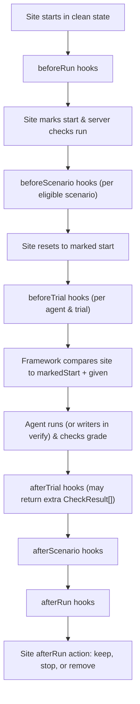

# Extending a project: hooks, entity types, agents, judges, and site kinds

How to prepare and clean up sites with hooks and extend `wp-ability-evals` from your project's `evals.config.ts` without modifying the package.

## Contents

- [Public package API](#public-package-api)
- [Hooks](#hooks)
- [Entity types](#entity-types)
- [Custom agents and judges](#custom-agents-and-judges)
- [Custom site kinds](#custom-site-kinds)

## Public package API

Everything a project may import is re-exported from [src/index.ts](../src/index.ts). Built-in agents, judges, entity types, site kinds, and `createGiven()` implement the exact same interfaces as project extensions.

## Hooks

A **hook** is a project function registered in `evals.config.ts` at one of six fixed lifecycle points. Each point is optional and accepts an array of functions executed in order:

```ts
// evals.config.ts
import { createGiven, defineConfig, isWpEnvSite, type RunHookContext } from 'wp-ability-evals';

async function seedTheShop({ site }: RunHookContext) {
  if (isWpEnvSite(site)) await site.wp(['post', 'create', '--post_title=Summer sale', '--post_status=draft']);
}

export default defineConfig({
  // ...
  hooks: {
    beforeRun: [seedTheShop],
    beforeScenario: [],
    beforeTrial: [createGiven()],
    afterTrial: [],
    afterScenario: [],
    afterRun: [],
  },
});
```

`createGiven()` is called where it is listed because it is a factory returning a `beforeTrial` hook; pass your own hook functions by reference without calling them.

### Lifecycle order



### Hook context

Every hook receives a single context object (`src/hooks/types.ts`):

- **`site`**: the started `Site`, providing `state()` and `apply(change)` (plain `SiteChange` values, no operators). For `wp-env` sites, narrow with `isWpEnvSite(site)` to access `site.wp(args)`, which runs WP-CLI as the admin user and returns stdout.
- **`run`**: `RunSetup` (`startedAt`, `site`, `agents`, `trialsPerScenario`). In `verify`, `run.agents` is empty.
- **`scenario`**: present on `beforeScenario`, `beforeTrial`, `afterTrial`, and `afterScenario`.
- **`agent` and `trial`**: present on `beforeTrial` and `afterTrial`. In `verify`, `agent` is `'verify'`.
- **`result`**: present on `afterTrial`; contains the `TrialResult` before after-trial hook checks are appended.

An `afterTrial` hook may return `CheckResult[]` (for example `[{ check: 'no-email-sent', pass: true, reason: 'No email was sent' }]`). Returned checks are validated at runtime and count toward trial pass/fail in live runs (ignored in `verify`).

### Failure semantics and cleanup guarantees

When a hook throws, the framework decides the impact:

| Hook point | Effect on the run |
| --- | --- |
| `beforeRun` | Stops the run before any trial; `afterRun` hooks still run; site is left as-is |
| `beforeScenario` | Marks every trial of that scenario "could not be judged" and continues to the next scenario |
| `beforeTrial`, `afterTrial` | Marks that trial "could not be judged" with hook name and error message |
| `afterScenario`, `afterRun` | Records the error in `run.json` (`errors`), continues running, and exits non-zero |

- A failing `before*` hook stops subsequent hooks at that same point.
- Every `after*` hook runs once its corresponding `before*` point was reached (even if a prior `after*` hook or trial failed), so cleanup is never skipped.
- Hooks have no built-in timeout; a hanging hook holds the run.
- Outside live runs: `site start` runs up to `beforeRun` + `markStart()`; `site check` runs through `markStart()`, server checks, and `afterRun`; `verify` runs all six points with writers in the agent's place.
- Set `"afterRun": "keep" | "stop" | "remove"` in `sites/<name>.json` (defaults to `"keep"`) to control what happens after `afterRun` hooks finish.

## Entity types

The site check sees only what registered **entity types** read. The package ships with one built-in type (`posts`, reading `title`, `status`, and `content`). To grade changes to options, pages, taxonomies, or custom tables, implement `EntityType` (`src/entities/types.ts`), register it under `entityTypes` in `evals.config.ts`, and list its name under `entities` in each pack's `pack.yaml`.

```ts
// extensions/settings.ts
import type { EntityType } from 'wp-ability-evals';

const NAMES = "['blogname', 'blogdescription']";

export const settings: EntityType = {
  name: 'settings',
  fields: ['value'],
  readers: {
    // PHP expression returning rows with `key` and every declared field.
    'wp-env': `array_map(fn($name) => ['key' => $name, 'value' => get_option($name)], ${NAMES})`,
  },
  writers: {
    // PHP statements receiving `$key` and `$fields` (map of fields or `'removed'`); throw Exception on failure.
    'wp-env': `
      if ($fields === 'removed') throw new Exception('a setting cannot be removed');
      if (!in_array($key, ${NAMES}, true)) throw new Exception('unknown setting');
      if (array_key_exists('value', $fields)) update_option($key, $fields['value']);`,
  },
};
```

Invariants for entity types:

- **Reader/writer key agreement:** Whatever key a writer creates an item under must be the exact key the reader reports back. Where a reader synthesizes a key (such as `#<ID>` for slugless posts), the writer must locate items by that key and refuse to create new ones under it.
- **Data-only changes:** On `wp-env`, change payloads arrive as JSON via stdin (never interpolated into PHP source), so values with quotes or `$` are safe.
- **Validation and error pinpointing:** `validate` verifies that `wp-env` readers/writers are strings; `site state` and `verify` evaluate each reader/writer independently and report syntax or runtime errors with the entity type name and line offset inside that snippet.
- **Optional writers:** `writers` may be omitted only for read-only entity types never referenced in `given` or `expect.site`.

## Custom agents and judges

Register custom adapters under `agents` and `judges` in `evals.config.ts` (`src/agents/types.ts`, `src/judge/types.ts`):

- **`Agent`**: `{ family: string; judge?: string; run(task: AgentTask): Promise<Transcript> }`. Run the agent in `task.workDir` (empty folder outside any repo) connected only to `task.mcpServer`, enforce `task.timeoutMs`, keep user settings/skills/memory isolated, and normalize tool calls into `ToolCall[]` (`server`, `tool`, `input`, `output`, `isError`).
- **`Judge`**: `{ family: string; model?: string; grade(input: JudgeInput): Promise<JudgeVerdict> }`. Grade `{ request, answer, rubric }` without tools and return `{ pass, reason }`. Throw when no verdict can be produced so the trial becomes "could not be judged" rather than a false failure.

## Custom site kinds

To evaluate against a non-`wp-env` WordPress target (such as a remote or container-managed site), implement `SiteFactory` (`(context: SiteContext) => Site` in `src/sites/types.ts`) and register it under `siteKinds` in `evals.config.ts`. Reference its key as `"kind"` in `sites/<name>.json`.

A `Site` implements:

- `start(): Promise<McpServer>` — returns the site to its clean state, forgets any marked start, and returns the MCP server connection details.
- `markStart()` and `reset()` — snapshot/restore the post-`beforeRun` baseline between trials.
- `state()` and `apply(change)` — read and mutate the entity types requested in `context.entityTypes`.
- `stop()` and `remove()` — lifecycle cleanup corresponding to `site stop`, `site remove`, and `afterRun`.
- Optional `requestFor?(scenario, pack): string` — rewrites the request per site before the agent runs (for example, naming the target site on a multi-site MCP server so committed scenarios stay site-agnostic).

On `McpServer` (`src/mcp-server.ts`):

- Set **`lookup`** (`LookupTools`) when the server exposes lookup tools (`runTools` with `tool`, `nameArgument`, `inputArgument`, and optional `prefix` for hybrid servers, plus `otherTools` for discovery/describe tools). Any other tool on the server is treated as one tool per ability (`/` mapped to `-`).
- Set **`inspectUrl`** when server checks (MCP Inspector) must hit a distinct URL or query parameter to inspect the exact tool surface agents see.
