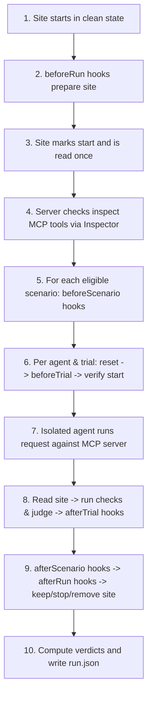

# Running, verifying, and reading results

How `verify` proves scenarios without an agent, how live runs execute and judge trials, how MCP tool presentation works, how to shard and merge runs, and how to inspect saved results in JSON or the viewer.

## Contents

- [Proving a scenario without an agent (`verify`)](#proving-a-scenario-without-an-agent-verify)
- [How a live run works](#how-a-live-run-works)
- [Server checks and ability definitions](#server-checks-and-ability-definitions)
- [How the agent reaches abilities](#how-the-agent-reaches-abilities)
- [Judges and multi-trial verdicts](#judges-and-multi-trial-verdicts)
- [Splitting runs with `--shard` and `merge`](#splitting-runs-with---shard-and-merge)
- [Reading results and using the viewer](#reading-results-and-using-the-viewer)

## Proving a scenario without an agent (`verify`)

Scenarios are often authored before the abilities they test exist, and live runs cost tokens. `npx wp-ability-evals verify --site <site> --no-judges` proves on a real site that a scenario's starting content, site check, and answer checks work as intended before any agent runs it.

`verify` runs up to five steps per scenario:

| Step | Action | Passing condition |
| --- | --- | --- |
| `start` | Resets to marked start, runs `beforeTrial` hooks, reads site | Matches `markedStart + scenario.given` |
| `no change` | Re-reads site with nothing done and runs site check | Fails if `expect.site` is set; passes if no change is expected |
| `the change` | Applies `expect.site` via entity writers and runs site check | Site check passes (only when `expect.site` is set) |
| `contains` | Checks `expect.answer.contains` against `reference` | `reference` contains every string (skipped if no `reference`) |
| `rubric` | Grades `reference` and `wrong` with every configured judge | Every judge passes `reference` and fails `wrong` (skipped with `--no-judges`) |

Example output:

```text
content/publish-a-draft/by-its-topic
  start       2 given items found on the site
  no change   fails, as it should: posts summer-sale: status is "draft", expected "publish"
  the change  passes
content/publish-a-draft/no-such-draft
  start       2 given items found on the site
  no change   passes, as it should: the scenario expects no change
  rubric      claude and gpt pass the reference answer and fail the wrong one
`expect.abilities` and `expect.forbidden` are not covered, because no agent runs: only a run shows which abilities an agent executes.
2 scenarios checked: 2 passed.
```

How to read failures and limits:

- **`FAILED:`** indicates a bug in the scenario (for example, `no change` passing because `expect.site` already holds at start, or `the change` failing because WordPress stored a different representation or a `$new` label collided with an existing item key).
- **`COULD NOT BE CHECKED:`** indicates an external stop (failed hook, unreachable site, or judge returning no verdict). Both `FAILED:` and `COULD NOT BE CHECKED:` exit non-zero; skipped steps (`--no-judges` or `contains` without `reference`) are counted on the summary line without failing.
- **How writers materialize operators:** `$new` items are created under their label as key with their plain values (so labels must not collide with existing keys on the site); `$contains` fields append their texts joined by a space onto the starting value.
- **State-independent:** `to-be-implemented` and `known-defect` scenarios are proved identically to `implemented` scenarios because entity writers stand in for the agent.
- **Hooks in `verify`:** All six hook points run in the same order as a live run, with `run.agents` empty and `agent` set to `'verify'`. After-trial hook results have no `transcript`, and checks returned by after-trial hooks are ignored because they would judge the writers instead of an agent.
- **What `verify` cannot prove:** `expect.abilities`, `expect.forbidden`, whether an agent understands the request, or whether an ability (rather than the entity writer) can make the change.

## How a live run works



Trials run sequentially on a site because they share its state. Each trial launches the agent in a fresh temporary folder outside any repository, with none of the user's settings, rules, skills, or memory and no indication that it is an evaluation.

## Server checks and ability definitions

Before running any trials, `run` inspects the site's MCP server once using MCP Inspector (`--strict`)—the same check `npx wp-ability-evals site check <site>` runs standalone:

- **Missing abilities:** Compares the server's tools against the packs listed in the site file. Scenarios naming a missing ability in `expect.abilities` are skipped without launching an agent: trials are recorded as "could not be judged" (or "not built yet" / "failed as expected" when `state: to-be-implemented`). If the MCP server is unreadable, every scenario is skipped and recorded.
- **Unlisted tools:** Reports tools exposed by the server that no pack lists (informational; does not fail `site check`).
- **Ability definition findings:** Checks each listed ability for schema portability (`--strict`), missing descriptions, and contradictory `readOnlyHint` annotations relative to the pack's `reads`/`writes` lists. `error`-severity findings fail `site check`; `warning`-severity findings are reported without failing. During `run`, definition findings are recorded in `run.json` without skipping trials.

Every live run also saves the raw MCP Inspector tool listing to `server.json` in the run folder.

## How the agent reaches abilities

A new project's `sites/local.json` loads the MCP Adapter together with the package's bundled `abilities-as-tools` plugin:

```json
"plugins": [
  "https://downloads.wordpress.org/plugin/mcp-adapter.0.7.1.zip",
  "./node_modules/wp-ability-evals/wp-plugins/abilities-as-tools"
]
```

By default, the MCP Adapter exposes three lookup tools that find, describe, and execute any WordPress ability. Because those three generic descriptions mention only "WordPress abilities", agents that rely on tool search can miss them (in testing, Codex missed them in 7 of 36 trials versus 1 of 20 with one tool per ability), turning server wording into false failures. `abilities-as-tools` exposes one MCP tool per ability on the same endpoint (for example `core-content-update` for `core/content-update`) and identifies the server as the user's WordPress site.

The framework's checks support **both** presentations—and hybrid servers—without changing scenarios:

- When an ability is exposed as its own tool, its name maps `/` to `-` and the tool's input is the ability's input.
- When a server exposes lookup tools (configured via `McpServer.lookup`), calls to discovery/describe tools execute no ability, and calls to a run tool resolve the ability name and input from that tool's configured `nameArgument` and `inputArgument` (for the MCP Adapter, `ability_name` and `parameters`).

Scenarios always name abilities, never MCP tool names, so the same pack runs unchanged across presentations.

## Judges and multi-trial verdicts

### Cross-family rubric judges

Code checks decide site state, abilities executed, and `expect.answer.contains`. Only `expect.answer.rubric` invokes a judge model (run via the same CLI with no tools). Each agent names its judge in `evals.config.ts`:

```ts
agents: {
  'claude-code': claudeCode({ model: 'claude-sonnet-5-5', signIn: 'login', judge: 'gpt' }),
  codex: codex({ model: 'gpt-6.2-sol', signIn: 'login', judge: 'claude' }),
},
judges: {
  claude: claudeJudge({ model: 'claude-sonnet-5-5', signIn: 'login' }),
  gpt: codexJudge({ model: 'gpt-6.2-sol', signIn: 'login' }),
},
```

Pair each agent with a judge from a **different model family**, because models pass answers from their own family more leniently. `validate` and `run` warn when an agent uses a same-family judge. If a judge fails to return a verdict, the trial ends as "could not be judged" (never a failure) while preserving the transcript and site readings.

### Why three trials

Agents are non-deterministic, so a single passing trial can be luck. Each agent runs every scenario `trials` times (default `3` in a new project), and a scenario passes only when **every trial of every agent** passes:

| Scenario reliability | Passes 1 trial | Passes 3 trials | Passes 5 trials |
| --- | --- | --- | --- |
| 50% (coin flip) | 1 in 2 runs | 1 in 8 runs | 1 in 32 runs |
| 80% | 4 in 5 runs | ~1 in 2 runs | ~1 in 3 runs |

Token cost and wall-clock time scale linearly with `trials`. Adjust `trials` in `evals.config.ts` (for example `5` for a stricter release gate) or override for one invocation with `--trials <number>`.

## Splitting runs with `--shard` and `merge`

Large `run` or `verify` invocations can be partitioned with `--shard <index>/<total>` (1-based). Selected scenarios (after `--filter`, if any) are assigned round-robin (`index % total`) so slower packs spread evenly across slices:

```bash
npx wp-ability-evals run --site local --agent claude-code --shard 1/4
npx wp-ability-evals verify --site local --no-judges --shard 1/4
```

Run shards **in parallel** when each slice targets its own isolated site, or **sequentially** when slices share one site.

Combine sharded or per-agent run folders back into one unified run with `merge`:

```bash
npx wp-ability-evals merge --out ./results ./shard-1/2026-11-23T03-00-00Z ./shard-2/2026-11-23T03-20-00Z
```

`merge` validates that all sources share the same `site` and `trialsPerScenario` with no duplicate `(scenario, agent, trial)` entries, copies all trial JSON files and `server.json`, merges model records, and recomputes per-scenario verdicts across every agent.

## Reading results and using the viewer

Each run writes to a timestamped folder inside `results/`:

```text
results/2026-11-19T08-18-01Z/
  run.json
  server.json
  trials/core/site/which-php-version/codex.1.json
```

- **`run.json`** (read this first): run configuration, models and judges used (`models`), server check findings (`serverChecks`), per-scenario verdicts, and a summary entry for every trial (outcome, failed checks, and relative path to its trial file). Written when the run finishes; an interrupted run still retains every completed trial under `trials/`.
- **`server.json`**: raw MCP Inspector tool snapshot captured during the run's server checks.
- **`trials/<scenario-id>/<agent>.<trial>.json`**: full trial detail—scenario definition, every check and reason, `site.before` and `site.after` readings, agent answer, tool calls with inputs/outputs, and raw agent output.

### Interactive and static viewer

Start the local read-only viewer (bound strictly to `127.0.0.1` / `localhost`, default port `4400`):

```bash
npx wp-ability-evals view
npx wp-ability-evals view --port 4420 --results ./merged-results
```

The viewer opens on an **Overview** showing:

- Ability coverage computed from each scenario's latest verdict (tested, passing, failing, and warnings when verdicts mix models).
- Abilities appearing in the most failing scenarios, plus `to-be-implemented` demand.
- Newest run's server checks (missing abilities, unlisted tools, and ability definition findings).
- Historical trend (one point per saved run, carrying forward each scenario's latest result so filtered runs do not cause false drops).
- Interactive ability map, searchable/filterable table, drill-down panels, run list, and per-trial inspector (showing computed site diffs, foldable pre-trial site state, checks, answer, and tool calls).

To publish results from CI or static hosting without running a server, export a self-contained static bundle (HTML, JS, CSS, and precomputed JSON data):

```bash
npx wp-ability-evals view --export ./viewer-export --results ./results
```
